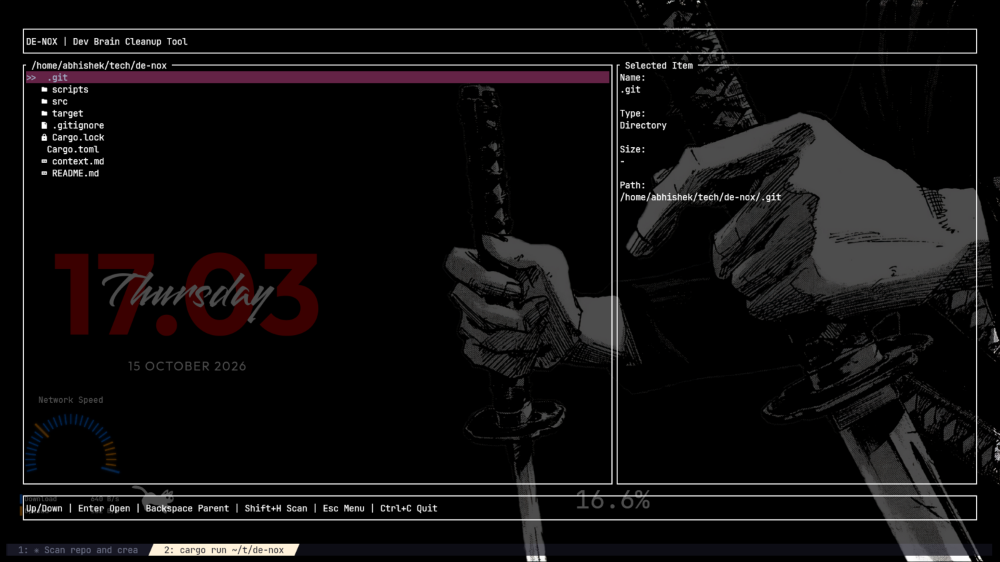
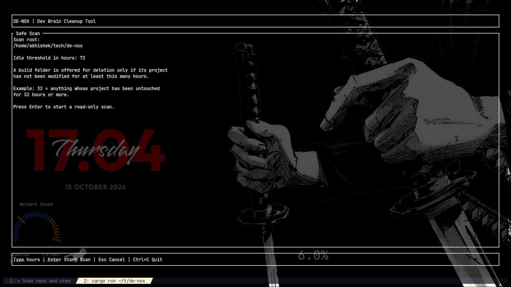
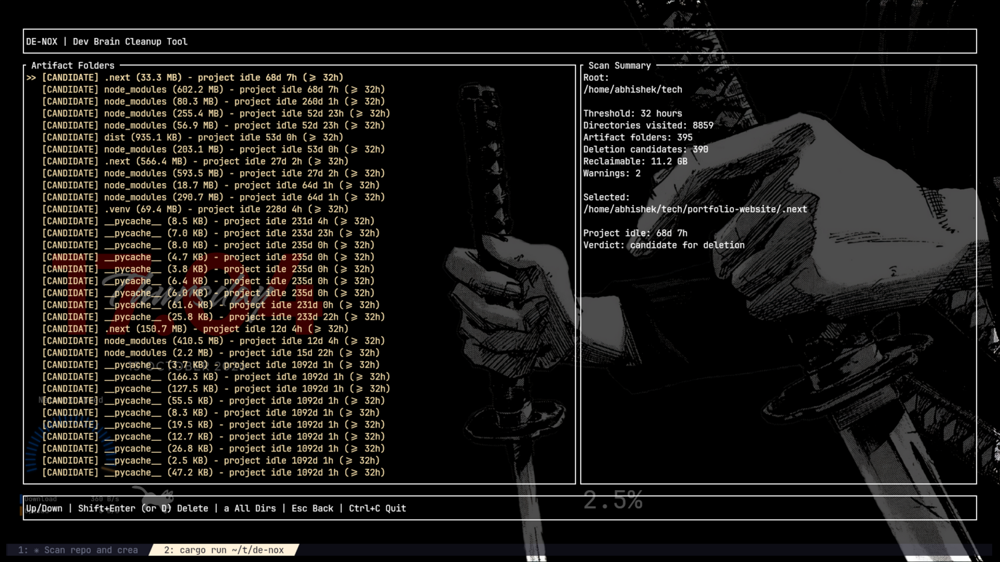

# de-nox

**A terminal disk-cleanup tool that knows the difference between a dead project and a busy one.**

`de-nox` is a small terminal application written in Rust. It walks a directory you choose, finds the folders that build tools and package managers generate, and tells you how long the project that owns each folder has been idle. It then removes only the folders you explicitly approve.

It is not a general-purpose system cleaner. It does not delete anything outside its artifact list, it does not require root, and it does not pretend that every large directory is disposable.

The interface is intentionally plain: a menu, a file browser, a scan result, and a confirmation screen. There is no account, no background service, and no telemetry. There is also no undo, which is discussed in the safety section.

The current source version is `0.1.1`. Its source is available at [github.com/soul-abhi/De-Nox](https://github.com/soul-abhi/De-Nox).

---

## Contents

- [The problem](#the-problem)
- [The rule that makes de-nox different](#the-rule-that-makes-de-nox-different)
- [What it looks like](#what-it-looks-like)
- [Installation](#installation)
- [First run](#first-run)
- [Keybindings](#keybindings)
- [Safety model](#safety-model)
- [What counts as an artifact](#what-counts-as-an-artifact)
- [History](#history)
- [Requirements](#requirements)
- [Development](#development)
- [Testbed](#testbed)
- [Releases and distribution](#releases-and-distribution)
- [Project status](#project-status)
- [License](#license)

---

## The problem

A working development machine accumulates a remarkable amount of disposable data. `node_modules`, `target`, `dist`, `.next`, `.venv`, `__pycache__` and their relatives are regenerable by design. Deleting the right ones is useful. Deleting the wrong ones turns a five-minute rebuild into an afternoon of reinstalling dependencies and explaining yourself.

Most cleanup scripts ask a simple question: how old is this folder? That question is convenient, and frequently wrong.

`npm install` writes `node_modules` once, at install time. A project you work on every day can still contain a `node_modules` whose timestamps are months old. Judge the folder by its own contents and you will confidently offer to delete the dependencies of your main project. The folder was not stale. It was simply finished being written.

`de-nox` asks a better question: how long has the project been untouched?

## The rule that makes de-nox different

For a folder at `<project>/node_modules`, `de-nox` examines `<project>` for its newest modification time while deliberately skipping the contents of every artifact directory. Your source files, configuration, and documentation are the real activity signal. Build output is not.

```text
project idle for 68d 7h  >= 32h threshold   ->  [CANDIDATE]  offered for deletion
project modified 2h ago                     ->  [PROTECTED]  left alone
```

The rule is deliberately one-directional. It may under-report candidates, but it will not over-report them. Three conditions always produce `[PROTECTED]`:

- the project is younger than the threshold;
- the project has no readable timestamps;
- any part of the project cannot be read completely.

The same design also makes the scan faster. `de-nox` never descends into an artifact directory, so a large dependency tree costs one directory entry rather than a full recursive walk. Nested artifacts are skipped as well, because the outer artifact already contains them.

## What it looks like

### Browsing

Choose the directory to clean. The right-hand pane describes the selected item; the left-hand pane is the filesystem.



### Choosing a threshold

One number decides everything: how many hours a project must have been untouched before its build folders become eligible. The default is 72 hours. A threshold of 32 hours is reasonable if you want to reclaim space aggressively; 72 hours is a calmer starting point.



### Reviewing the scan

Every artifact folder is listed with its size, its project's idle time, and a verdict. The summary pane reports the number of directories visited, the number of artifacts found, the number of candidates, and the total reclaimable space. The scan itself is read-only.



The screenshot above is a real scan of a `~/tech` directory tree: 8,859 directories visited, 395 artifact folders found, 390 candidates, and 11.2 GB reclaimable. The projects that were actively being worked on were left untouched. That is the intended outcome, even if it makes for a less dramatic screenshot.

---

## Installation

### A note about release assets

Releases built before the current distribution pipeline was completed may not contain binaries. The `v0.1.0` release is one such case: it has no downloadable assets beyond the source snapshots GitHub attaches automatically. Starting with `v0.1.1`, every release is built by `cargo-dist` and carries the archives, installer, and checksums described below. If a future release ever appears without them, the release failed rather than chose austerity, and a source build is the fallback.

### Shell installer

For releases built by the current pipeline, the shell installer is the shortest path:

```bash
curl --proto '=https' --tlsv1.2 -LsSf \
  https://github.com/soul-abhi/De-Nox/releases/latest/download/de-nox-installer.sh | sh
```

The installer detects the platform, downloads the appropriate archive, and places the binary in `$CARGO_HOME/bin`, which is normally `~/.cargo/bin`. It also installs a small updater named `de-nox-update`. Run that command later to check for and install a newer release.

If piping a remote script into a shell makes you uncomfortable, that is a reasonable position. Use a prebuilt archive or build from source instead.

### Prebuilt archives

The release pipeline publishes four Linux archives:

| Target | Archive | Typical use |
| :--- | :--- | :--- |
| `x86_64-unknown-linux-gnu` | `de-nox-x86_64-unknown-linux-gnu.tar.xz` | Standard 64-bit glibc distributions |
| `x86_64-unknown-linux-musl` | `de-nox-x86_64-unknown-linux-musl.tar.xz` | Portable 64-bit build, statically linked |
| `aarch64-unknown-linux-gnu` | `de-nox-aarch64-unknown-linux-gnu.tar.xz` | 64-bit ARM with glibc |
| `aarch64-unknown-linux-musl` | `de-nox-aarch64-unknown-linux-musl.tar.xz` | Portable 64-bit ARM build |

Each archive contains the `de-nox` binary, the `LICENSE`, and this `README.md`. A unified `sha256.sum` file is published beside the archives. To verify and unpack a download:

```bash
curl -fLO https://github.com/soul-abhi/De-Nox/releases/latest/download/de-nox-x86_64-unknown-linux-musl.tar.xz
curl -fLO https://github.com/soul-abhi/De-Nox/releases/latest/download/sha256.sum
sha256sum --ignore-missing -c sha256.sum
tar -xJf de-nox-x86_64-unknown-linux-musl.tar.xz
```

The archive unpacks into a directory named after the archive. The binary is inside it and can be moved wherever you keep local executables:

```bash
install -Dm755 de-nox-x86_64-unknown-linux-musl/de-nox ~/.local/bin/de-nox
```

### From source

The source build is always available, and it is the option to use when you want to inspect or modify the code. The repository pins its Rust toolchain in `rust-toolchain.toml`; `rustup` will honour it.

```bash
git clone https://github.com/soul-abhi/De-Nox.git
cd De-Nox
cargo build --release
./target/release/de-nox
```

To install the resulting binary into your Cargo binary directory:

```bash
cargo install --path .
```

`de-nox` is not currently published on crates.io, so `cargo install de-nox` will not work. The command above installs from the checkout you already have.

---

## First run

Start `de-nox` in the current directory, or give it a starting directory:

```bash
de-nox
de-nox ~/code
de-nox --help
de-nox --version
```

The normal Safe Scan flow is:

1. Select **Safe Scan** from the menu.
2. Navigate to the directory you want to examine. `Enter` opens a directory and `Backspace` returns to its parent.
3. Press `Shift+H` to open the threshold prompt.
4. Enter a number of hours, such as `72`, and press `Enter`. The scan runs on a worker thread and is read-only.
5. Review the results. `[CANDIDATE]` folders are eligible; `[PROTECTED]` folders are not.
6. Press `Shift+Enter` or `D` to build the deletion queue.
7. Press `Enter` on the confirmation screen to delete permanently, or `Esc` to cancel.

Everything before the final `Enter` is read-only. Cancelling at the confirmation screen leaves the filesystem exactly as it was.

A reasonable first run is to point `de-nox` at a single project directory rather than your entire home directory. Confidence is easier to acquire in small amounts.

---

## Keybindings

`Ctrl+C` quits from any screen. On the deletion screen it requires a second press, because interrupting a running `remove_dir_all` can leave a directory partly removed.

| Screen | Keys |
| :--- | :--- |
| Menu | `Up` / `Down`, `Enter` to select, `q` to quit |
| Browser | `Up` / `Down`, `Enter` to open, `Backspace` for parent, `Shift+H` to scan, `Esc` for menu, `q` to quit |
| Threshold input | digits, `Backspace`, `Enter` to start, `Esc` to go back |
| Scanning | `Esc` to cancel |
| Scan results | `Up` / `Down`, `Shift+Enter` or `D` to delete candidates, `a` for all directories, `Esc` to go back |
| All directories | `Up` / `Down`, `Esc` to go back |
| Confirmation | `Enter` to delete permanently, `Esc` to cancel |
| Deleting | input is ignored, except `Ctrl+C` twice to force quit |
| Delete report | `Enter` or `Esc` to return to the browser, `q` to quit |
| History | `Up` / `Down`, `Enter` to open a session, `Esc` for menu, `q` to quit |
| History detail | `Up` / `Down`, `Esc` to return to the session list |

A note about `Shift+Enter`: many terminals cannot distinguish it from a plain `Enter` without the kitty keyboard protocol. `D` is wired as an equivalent and works everywhere. The `Shift+Enter` binding remains documented because it is the intended key, but `D` is the one to remember when the terminal declines to cooperate.

---

## Safety model

Deletion is permanent. `de-nox` calls `remove_dir_all`; it does not use the system trash. The confirmation screen exists because that distinction matters.

Every guard lives in one function, `check_deletable`, and that function is re-run immediately before each deletion rather than trusting the verdict from scan time. A path is refused if any of the following is true:

| Guard | Refused path |
| :--- | :--- |
| Name allowlist | anything whose directory name is not a recognized artifact |
| Scan root | the directory the scan started from |
| Containment | any path outside the scan root |
| Depth floor | paths with fewer than four components, which keeps `/`, `/home`, and `/home/user` out of reach |
| Symbolic link | an artifact that is a symlink; links are never followed |
| Type check | a path that is no longer a directory |
| Re-validation | a project that has been modified since the scan completed |

The last guard is the useful one. It makes it safe to leave the confirmation screen open while you do something else. If you start working on a project in the meantime, its artifacts are dropped from the queue and reported as `[KEPT]` with the reason.

A failure on one path does not abort the batch. It is recorded, shown in the report, and the remaining deletions proceed.

The scan does not follow symbolic links at any point. Unreadable directories produce warnings and cause the affected project to be protected, not guessed at. The application has no network access, no background process, and no mechanism for deleting anything you have not confirmed.

## What counts as an artifact

Only directories that a standard project command can regenerate are considered:

```text
node_modules   target        dist      build     .next     .nuxt
.output        .turbo        .cache    venv      .venv     __pycache__
.pytest_cache
```

Nothing else is eligible at any threshold. A folder containing unique work does not belong in this list, regardless of how old it looks or how much space it occupies.

Nested artifacts are not listed separately. An outer `node_modules` already covers everything inside it, and the scan deliberately does not descend into artifact directories.

---

## History

Every cleanup session is recorded, including a session that deleted nothing. A record of a scan that kept everything is still a useful record of a decision.

The History screen lists past sessions, newest first. Open one to see every path it deleted or kept, along with the reason for each decision. The `[KEPT]` entries are the more informative half: they make a protection decision auditable long after the fact.

History is stored at `$XDG_DATA_HOME/de-nox/history.log`, falling back to `~/.local/share/de-nox/history.log`. The format is an append-only, tab-separated log. A crash during a write can truncate the tail of the file, but it cannot corrupt an earlier session. Malformed lines are skipped with a warning rather than discarding the entire file.

History records paths, not contents. It tells you what was removed; it does not offer to bring anything back. Recovery means rebuilding or reinstalling the affected project, which is exactly what the artifact allowlist is designed to make possible.

The log currently has no built-in pruning command. Delete the file by hand if it becomes inconvenient.

---

## Requirements

| | |
| :--- | :--- |
| Operating system | Linux is the supported target. The code uses only standard filesystem APIs, so other Unix systems are likely to work, but they are not part of the tested distribution matrix. |
| Rust | Edition 2024. The repository pins Rust `1.99.0` in `rust-toolchain.toml`. |
| Terminal | Any ANSI terminal. A Nerd Font provides the file-type glyphs in the browser; without one, those glyphs degrade to blank boxes and nothing else changes. |

Direct dependencies are `ratatui`, `crossterm`, `walkdir`, `chrono`, and `clap`. `serde` and `nerd_fonts` are also declared in `Cargo.toml`, although the current source does not use either; history is written as a small hand-rolled tab-separated format, and the file icons are string literals. There is no async runtime, and reading a log cannot fail because a JSON schema changed.

---

## Development

```bash
cargo fmt --all -- --check
cargo clippy --all-targets -- -D warnings
cargo test --all-targets
cargo run -- ~/some/directory
```

The test suite contains 22 tests. They build real fixture trees under the system temporary directory and backdate file times with `File::set_times`, so the tests exercise actual filesystem behaviour rather than a mock. One test performs a real `remove_dir_all` inside its own temporary directory. Coverage concentrates on the parts capable of destroying data: the eligibility rule, every deletion guard, nested-artifact skipping, the history round-trip, and recovery from a corrupt history log.

The application is a single-file binary crate. The main event loop, the screen state machine, the scan worker, the delete worker, and the tests all live in `src/main.rs`. Scanning and deletion run on worker threads and report progress over an `mpsc` channel; the interface polls that channel every 60 milliseconds so the spinner and counters continue to animate without blocking input.

The repository layout is:

```text
src/main.rs                      application source and tests
scripts/make-testbed.sh          generates a disposable tree of fake projects
scripts/fatten-testbed.sh        installs real dependencies into that tree
scripts/verify-release.sh        checks a published release end to end
docs/screenshots/                the screenshots used in this README
dist-workspace.toml              cargo-dist configuration
.github/workflows/ci.yml         formatting, Clippy, and tests
.github/workflows/release.yml    generated cargo-dist release workflow
.github/workflows/verify-release.yml  post-publish asset verification
```

## Testbed

Two scripts build and populate a disposable corpus. Run them in order:

```bash
scripts/make-testbed.sh   ~/tech/dump
scripts/fatten-testbed.sh ~/tech/dump
```

`make-testbed.sh` is fast and offline. It creates 20 project trees covering stale, active, borderline, nested, symlinked, unreadable, artifact-free, and monorepo cases, and writes an `EXPECTATIONS.md` file listing the verdict each case should receive at a 32-hour threshold. On its own, it produces placeholder artifacts totalling roughly 21 MB.

`fatten-testbed.sh` is slower and requires network access. It replaces the placeholders with real `npm install`, `cargo build`, and `python -m venv` output, bringing the corpus to roughly 2.8 GB.

The two scripts are coupled for a specific reason. npm, cargo, and pip all write files into the project root, such as `package-lock.json`, `Cargo.lock`, and `pyvenv.cfg`. Those files are not artifacts, so after installation every project looks freshly active and `de-nox` correctly protects everything. `make-testbed.sh` therefore records every backdating operation in `.denox-ages`, and `fatten-testbed.sh` replays that log as its final step. Installing without replaying the log produces a testbed with zero candidates.

Safe Scan deletes for real, so regenerate the testbed between destructive runs. The generator refuses to touch a non-empty directory that does not carry its own `.denox-testbed` marker.

---

## Releases and distribution

Releases are built with [`cargo-dist`](https://axodotdev.github.io/cargo-dist/) version `0.34.0`. The configuration is kept in `dist-workspace.toml` rather than scattered through the workflow file. `.github/workflows/release.yml` is generated by cargo-dist and should be treated as generated output: change the configuration first, then regenerate the workflow instead of editing it by hand.

The current distribution configuration provides:

| Setting | Value |
| :--- | :--- |
| Targets | `x86_64-unknown-linux-gnu`, `x86_64-unknown-linux-musl`, `aarch64-unknown-linux-gnu`, `aarch64-unknown-linux-musl` |
| Installer | Shell installer |
| Install location | `$CARGO_HOME/bin` |
| Updater | Installed as `de-nox-update` |
| Archive contents | Binary, `LICENSE`, and `README.md` |
| Build profile | `dist` profile inherited from `release`, with thin LTO |
| Checksums | Per-archive SHA-256 files and a unified `sha256.sum` |
| Additional assets | Source tarball, its checksum, and four `de-nox-<target>-update` binaries |

The pipeline is triggered by pushing a SemVer tag. The workflow pattern accepts tags such as `v0.1.1`; a tag that does not contain a valid `major.minor.patch` version will not start a release, and its silence is intentional.

A release is made as follows:

1. Update the version in `Cargo.toml` and refresh `Cargo.lock`.
2. Commit the version change.
3. Create and push a tag:

   ```bash
   git tag v0.1.1
   git push origin v0.1.1
   ```

4. The workflow plans the release, builds each target, assembles the installer and checksums, creates the GitHub release, uploads the assets, and announces the result.
5. The `Verify release` workflow starts when the release is published. It confirms that every expected asset exists, verifies `sha256.sum`, unpacks the archive for the runner's architecture, and runs `de-nox --version`.

The same check can be run locally against any published tag:

```bash
scripts/verify-release.sh v0.1.1
```

The script exits non-zero on the first missing file, bad checksum, or version mismatch. A release that exists only as an empty page therefore does not pass verification, which is the point.

Manual uploading is not part of the process. The pipeline produces the archives, the shell installer, the checksums, and the standalone updater; reproducing that work by hand is a good way to produce a release that disagrees with its own metadata.

The CI workflow in `.github/workflows/ci.yml` runs formatting checks, Clippy with warnings treated as errors, and the test suite on pushes and pull requests. It does not publish anything. Publishing belongs solely to the cargo-dist workflow, so two jobs cannot race to assemble the same release.

---

## Project status

| Feature | State |
| :--- | :--- |
| **Safe Scan** — browse, scan, review, confirm, delete | Implemented |
| **History** — past sessions and their decisions | Implemented |
| **Deep Clean** | Listed in the menu; not implemented |

The current limitations are known and deliberate enough to be stated plainly:

- **Deep Clean does not exist yet.** Selecting it displays a notice. It is an honest menu entry, not a hidden feature.
- **Deletion is permanent.** There is no trash, recycle bin, or undo. Rebuild or reinstall to recover an artifact.
- **The history log has no in-application pruning.** Remove the file manually if it grows inconvenient.
- **History records paths, not contents.** It is an audit log, not a backup system.
- **`Shift+Enter` is not reportable by every terminal.** Use `D`; it is the binding that always works.
- **There is no panic hook.** A panic inside the interface could leave the terminal in raw mode. Running `reset` restores it.
- **The distributed binaries target Linux only.** The build matrix is the authoritative list of supported platforms.
- **A Nerd Font is optional.** Without one, file icons render as blank boxes; the rest of the interface remains usable.
- **`serde` and `nerd_fonts` remain declared but unused.** They are harmless, if slightly untidy, leftovers.

The most important invariant for future work is simple: nothing enters the artifact list unless a standard project command can regenerate it. A more aggressive cleanup mode must not reuse the existing deletion guards with looser arguments. It would need its own guards and its own confirmation screen.

---

## License

Released under the [MIT License](LICENSE).

Deletion is permanent. The confirmation screen is not decorative.
